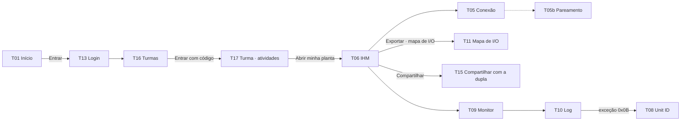
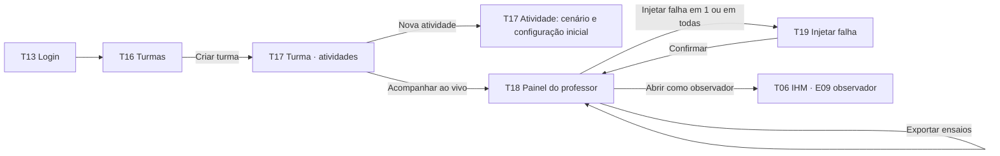
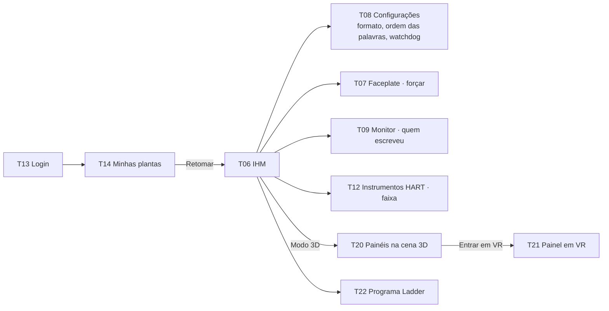

# Mapa de telas e fluxos

Etapa D1, parte A. Lista todas as telas do IndustrialSim Web (as que já existem e as das Fases 2 a 4), como se chega a cada uma e os fluxos dos perfis de `perfis-e-tarefas.md`. Cada tela tem um identificador (T01…) usado nos wireframes, no protótipo, no roteiro do teste e no relatório.

Critério da D1 ligado a este arquivo: "todas as telas do mapa existem no protótipo e cobrem os fluxos do visitante, do aluno e do professor". A coluna "Prancha" traz o arquivo da prancha nos wireframes (`wf:`, parte B) e, depois, no protótipo (`pt:`, parte D); a correspondência é conferida por script na parte F. Links dos canvases em `README.md`.

## Inventário das telas atuais (Etapas 7 e 8)

Hoje a navegação é mínima, pelo caminho da URL (`web/src/ui/navigation.ts`), e as seções da planta ficam no fragmento (`#process`, `#communication`, `#monitor`, `#log`). Observações feitas por inspeção das telas (capturas em `docs/validacao/img/etapa-07-*` e `etapa-08-*`); não são resultados de teste, e o teste da parte E vai confirmá-las ou não.

| Tela atual | Rota | Conteúdo | Observações para o redesenho |
| --- | --- | --- | --- |
| Início | `/` | Título, escolha de cenário (`ScenarioPicker`), estado do servidor (`HealthStatus`: versão e hora). | Não diz o que é o site nem como funciona; o estado do servidor é informação de desenvolvimento (vai para o rodapé ou "Sobre"). |
| Planta · Processo | `/plants/{id}#process` | Barra com nome, chip "Conectado", situação, tempo simulado, reinícios e cinco botões de mesmo peso (ensaio CSV, mapa CSV, mapa PDF, pausar, reiniciar). Sinóptico SVG, tendências; à direita, valores forçados, mestre Modbus, alarmes, distúrbios. | "Conectado" (navegador) e "Mestre conectado" se confundem; exportações com o mesmo peso de pausar e reiniciar; alarmes abaixo de outros painéis, às vezes fora da tela; IP, porta e Unit ID aparecem aqui e de novo em Comunicação; reiniciar usa o `confirm` do navegador. |
| Planta · Comunicação | `#communication` | Configurações (IP e porta só leitura, Unit ID, formato, ordem das palavras, watchdog, diagnóstico, mestres permitidos; Aplicar e Desfazer) e Mestres e conexões (estatísticas, IPs autorizados com Retirar, conexões abertas). | Junta "como ligo meu mestre" (pareamento, IPs) e "como a planta se comporta" (formato, watchdog). A tarefa T3 testa se as pessoas acham o formato aqui. |
| Planta · Monitor | `#monitor` | Tabela por área (coils, entradas discretas, holding e input registers, bloco de diagnóstico), com endereço (base 0 ou clássica), sinal, bruto, engenharia, última escrita e forçar. | Denso e útil para o PRF; os controles de forçar ocupam muito espaço em todas as linhas; não há filtro nem destaque da linha recém-escrita. |
| Planta · Log | `#log` | Tabela de eventos (horário, evento, autor), com contagem de repetidos. | Sem filtro por tipo; exceções Modbus não se destacam de eventos normais. |
| Diálogo de pareamento | (sobre a planta) | "Aceitar conexão de {IP}?", prazo, Aceitar e Recusar; aviso no modo um por vez. | Funciona; falta dizer de onde o pedido vem (porta, quando chegou) e como achar o próprio IP. |
| Mapa de I/O | `/plants/{id}/io-map` | Tabela para imprimir ou salvar em PDF, no formato atual. | Mantém a função; ganha cabeçalho com a identidade visual. |

## Modelo de navegação proposto

*(Revisto em 23/11/2026, a pedido do autor: abas como no navegador e planta sem barra global.)*

Fora e dentro de uma planta a navegação muda, para a planta ocupar a tela:

1. **Fora da planta: barra global** (início, cenários, minhas plantas, turmas, login): logotipo (volta ao início), Cenários, Minhas plantas, Turmas, Ajuda (guias de mestres), idioma, tema claro ou escuro, conta (ou "Entrar" para o visitante). O visitante vê "Cenários", "Ajuda" e "Entrar".
2. **Dentro da planta: sem barra global.** No lugar dela, uma faixa de abas como a do navegador:
   - **⌂** sai da planta para Minhas plantas (visitante: início).
   - **Nome da planta ▾** abre o menu da planta (T24): Minhas plantas, abrir outra planta, turmas, renomear, ajuda, idioma, tema e conta. Avisa que sair não desliga a planta.
   - **Abas:** Processo fica fixa (não fecha); as outras ferramentas abrem em abas que se fecham (×) e se reordenam (arrastar).
   - **+** abre o menu de nova aba (T23), com busca e um clique por ferramenta: Conexão, Configurações, Monitor, Log, Mapa de I/O (abre a página de impressão), detalhe de cada instrumento, Configurador HART (Fase 3), Programa Ladder (Fase 4). Ferramenta já aberta: o clique vai para a aba dela.
   - As abas abertas ficam lembradas por planta, só neste navegador.
3. **Barra de estado da planta** (logo abaixo das abas, sempre visível em qualquer aba): **estado do mestre** em destaque (nenhum, aguardando pareamento, conectado, com erro), situação (rodando, pausada), tempo simulado, alarmes ativos, Pausar ou Retomar, Reiniciar, menu Exportar (ensaio CSV, mapa de I/O CSV e PDF), Compartilhar (com conta) e, para o visitante, o tempo restante. O estado do WebSocket do navegador só aparece quando há problema (reconectando, incompatível).

A cena 3D (Fase 3) é um modo de visualização da aba Processo, não uma aba à parte.

**Por que um clique e não duplo clique no menu de nova aba:** o duplo clique é difícil de descobrir, não existe em tela de toque e exige uma alternativa de teclado de qualquer forma (WCAG 2.1.1). Abrir com um clique segue a página de nova aba dos navegadores. O teste (parte E) confirma se as pessoas encontram as ferramentas pelo +.

As rotas seguem o padrão atual (`/plants/{id}`, aba ativa no fragmento, ex.: `#monitor`), para que o Voltar do navegador funcione e a D2 mude o mínimo de código.

## Telas

Fidelidade no protótipo: **A** alta (identidade visual, dados realistas, interação nos fluxos do teste), **M** média (estrutura e conteúdo reais, poucos detalhes visuais). Nível ISA-101: hierarquia de telas da IHM (1 visão geral de várias unidades; 2 uma unidade de processo; 3 detalhe de um equipamento ou instrumento; 4 diagnóstico), segundo Hollifield et al., *The High Performance HMI Handbook* (2008), que segue a ANSI/ISA-101.01-2015. Só se aplica às telas de operação.

| ID | Tela | Rota proposta | Etapa que implementa | Perfis | ISA-101 | Fid. | Hoje | Prancha |
| --- | --- | --- | --- | --- | --- | --- | --- | --- |
| T01 | Página inicial | `/` | D2 | VIS, ALU, PRO, PRF | — | A | parcial | wf: `Main` |
| T02 | Menu principal (barra global e menu da conta) | todas | D2 | todos | — | A | não | wf: `T02-Menu` |
| T03 | Seleção de cenários | `/scenarios` | D2 | VIS, ALU, PRF | — | A | parcial | wf: `T03-Cenarios` |
| T04 | Criar e abrir planta (diálogo, "abrindo…", erros) | `/scenarios` | D2 (Etapa 10 para salvar) | VIS, ALU, PRF | — | A | parcial | wf: `T04-CriarPlanta` |
| T05 | Conexão do mestre (dados, guias, mestres autorizados, conexões) | `/plants/{id}#connection` | D2 | VIS, ALU, PRF | 4 | A | parcial | wf: `T05-Conexao` |
| T05b | Diálogo de pareamento | sobre a planta | D2 | VIS, ALU, PRF | — | A | sim | wf: `T05b-Pareamento` |
| T06 | IHM · Processo (sinóptico, alarmes, tendências, distúrbios) | `/plants/{id}#process` | D2 | todos | 2 | A | sim | wf: `T06-IHM` |
| T07 | Detalhe de instrumento (faceplate: PV, mA, faixa, forçar, tendência) | painel lateral em T06 | D2 | ALU, PRF | 3 | A | não | wf: `T07-Faceplate` |
| T08 | Configurações da planta | `/plants/{id}#settings` | D2 | ALU, PRO, PRF | 4 | A | sim (em Comunicação) | wf: `T08-Configuracoes` |
| T09 | Monitor de registradores | `/plants/{id}#monitor` | D2 | ALU, PRF | 4 | A | sim | wf: `T09-Monitor` |
| T10 | Log de comunicação | `/plants/{id}#log` | D2 | ALU, PRF | 4 | A | sim | wf: `T10-Log` |
| T11 | Mapa de I/O (impressão e PDF) | `/plants/{id}/io-map` | D2 | ALU, PRF | — | M | sim | wf: `T11-MapaIO` |
| T12 | Configurador HART (instrumentos, parâmetros, quadros, ponte PACTware) | `/plants/{id}#instruments` | 17, 18 | PRF, ALU | 4 | M | não | wf: `T12-HART` |
| T13 | Entrar e criar conta (e-mail, Google, Microsoft, GitHub; continuar como visitante) | `/login` | 10 | ALU, PRO, PRF | — | A | não | wf: `T13-Entrar` |
| T14 | Minhas plantas | `/plants` | 10 | ALU, PRO, PRF | — | A | não | wf: `T14-MinhasPlantas` |
| T15 | Compartilhar planta (e-mail ou código de 1 uso ou vários, com validade; pessoas com acesso; sem papéis) | diálogo sobre T06 ou T14 | 11 | ALU, PRF | — | A | não | wf: `T15-Compartilhar` |
| T16 | Turmas (minhas turmas, criar, entrar com código de turma ou de planta) | `/classes` | 12 | ALU, PRO | — | A | não | wf: `T16-Turmas` |
| T17 | Turma e atividades (professor cria; aluno abre a planta da atividade) | `/classes/{id}` | 12 | ALU, PRO | — | A | não | wf: `T17-Turma` |
| T18 | Painel do professor (plantas da turma ao vivo) | `/classes/{id}/live` | 12 | PRO | 1 | A | não | wf: `T18-Painel` |
| T19 | Injetar falha ou distúrbio (diálogo, em uma ou em todas as plantas) | diálogo sobre T18 ou T06 | 12 (falhas: 16) | PRO, ALU | — | A | não | wf: `T19-InjetarFalha` |
| T20 | Painéis sobre a cena 3D (HUD: faceplate do instrumento apontado, alarmes, menu) | `/plants/{id}#process` (modo 3D) | 14 | todos | 2–3 | M | não | wf: `T20-Cena3D` |
| T21 | Painel em VR (menu de pulso e faceplate flutuante) | sessão WebXR | 19 | todos | 3 | M | não | wf: `T21-VR` |
| T22 | Editor Ladder (esboço) | `/plants/{id}#program` | 22 | PRF, ALU | — | M | não | wf: `T22-Ladder` |
| T23 | Nova aba (menu do +: abrir ferramenta ou instrumento) | sobre a planta | D2 | todos | — | A | não | wf: `T23-NovaAba` |
| T24 | Menu da planta (sair, outras plantas, turmas, idioma, tema, conta) | sobre a planta | D2 | todos | — | A | não | wf: `T24-MenuPlanta` |

Fora do mapa por ora (sem tela própria na D1): conta e privacidade (exportar e excluir conta, LGPD, Etapas 10 e 13), termos de uso, editor FBD (Etapa 23, segue o modelo do T22), reprodução de ensaio gravado (entra como ação em T14 ou T06 quando a etapa existir).

## Estados especiais

Estados que mudam uma tela sem criar outra. Entram no protótipo como variantes das telas indicadas.

| ID | Estado | Telas | Como aparece |
| --- | --- | --- | --- |
| E01 | Sem mestre conectado | T06, T05 | Faixa na IHM com IP, porta e Unit ID e o link "Como conectar meu mestre"; estado vazio em T05 com os guias. |
| E02 | Pedido de pareamento pendente | todas da planta | Diálogo T05b; se fechado sem responder, aviso persistente na barra da planta até o prazo. |
| E03 | Alarme ativo (inclui watchdog disparado) | T06, T18, T20 | Banda de alarmes no topo da IHM; símbolo e cor de prioridade no sinóptico; contagem na barra da planta. |
| E04 | Valor forçado | T06, T07, T09 | Marca "FORÇADO" no valor (cor própria de estado anormal + texto), lista de forçados com Liberar. |
| E05 | Planta pausada | T06, T09, T18 | Faixa explicando que o mestre continua rodando; controles de distúrbio continuam, o tempo simulado para. |
| E06 | Reconectando / versão incompatível / planta encerrada ou expirada | todas da planta | Faixa de aviso (reconectando) ou tela de erro com a ação certa (recarregar, abrir outra planta). |
| E07 | Servidor lotado / sem porta Modbus livre | T04 | Erro no diálogo, com o que fazer (tentar de novo em minutos). |
| E08 | Visitante perto do limite de 60 min | barra da planta | Tempo restante sempre visível; aviso aos 10 min, com convite para criar conta. |
| E09 | Professor observando (sem permissão de comando) | T06, T08, T09 | Controles desabilitados com o motivo ("Você está observando esta planta"). Só acontece pelo painel da turma (ver pergunta 9). |
| E10 | Falha de instrumento injetada | T06, T07, T18 | Valor na corrente de falha NAMUR (3,6 ou 21 mA), marcado como falha; o professor sempre vê, o aluno só se o professor escolher avisar (T19). |

Pranchas dos estados nos wireframes: E01 e E08 em `E01-SemMestre`; E02 em `T05b-Pareamento`; E03, E04 e E10 em `EA-Alarme`; E05 e E09 em `EB-Pausada`; E06 em `EC-Avisos`; E07 em `T04-CriarPlanta`.

## Perguntas abertas (wireframes)

Decisões de interface que os wireframes propõem e que a revisão (fim da parte B) ou o teste (parte E) precisam confirmar:

1. **Sem mestre:** a IHM mostra uma faixa com IP, porta e Unit ID (E01). Basta, ou a planta deveria abrir direto na aba Conexão?
2. **Pedido de pareamento:** diálogo modal; se a pessoa fechar sem responder, a barra da planta mantém o aviso até o prazo de 60 s (D38).
3. **Comunicação dividida em Conexão e Configurações**, abertas pelo + (T23): a tarefa T3 mede se as pessoas acham o formato analógico sem ver as seções listadas na tela.
4. **Forçar** sai da linha do monitor (hoje um controle em cada linha) e vai para o menu da linha e para o faceplate (T07).
5. **Aviso ao aluno quando o professor injeta falha:** o padrão proposto é não avisar (o aluno diagnostica); o professor escolhe em T19.
6. **Prioridade de alarme:** a banda de alarmes (E03) mostra prioridade por forma e número, mas a seção `hmi.alarms` do cenário (D39) ainda não tem prioridade. Se a ideia ficar, a D2 ou a Etapa 15 acrescenta o campo ao `scenario.json` (decisão nova).
7. **Pausar e Reiniciar** ficam na barra da planta; as exportações (ensaio CSV, mapa de I/O CSV e PDF) vão para um menu "Exportar".
8. **Comandos do mestre** aparecem no sinóptico, ao lado da posição de cada válvula ("cmd do mestre 82,3 %"), em vez de um painel próprio, para sobrar espaço à planta (revisão de 23/11).
9. **Compartilhamento sem papéis** (revisão de 23/11, pedido do autor): quem recebe o convite tem os mesmos direitos de quem compartilhou; só quem criou a planta a exclui e remove pessoas. O acesso só de leitura fica para o professor que observa a planta de um aluno pela turma. **Contraria a D15 e o RF09** (papéis dono, operador e observador) e a tabela "Compartilhamento" do descritivo; a decisão nova é registrada ao fim da D1, com a confirmação do autor.
10. **Código de acesso à planta**: gerado em T15, de 1 uso ou de vários usos, com validade e revogável; digitado em Minhas plantas ou Turmas, no mesmo campo que aceita código de turma, ou aberto como link.

## Fluxos

### Visitante: do início ao mestre controlando a planta (T1, T2, T3)

```mermaid
flowchart LR
  T01[T01 Início] -->|Experimentar sem conta| T03[T03 Cenários]
  T03 -->|Abrir planta| T04[T04 Criar planta]
  T04 -->|abrindo…| T06[T06 IHM · Processo<br/>E01 sem mestre]
  T06 -->|faixa: abrir a aba Conexão| T05[T05 Conexão<br/>IP, porta, Unit ID, guias]
  T05 -.->|o mestre conecta| T05b[T05b Pareamento]
  T05b -->|Aceitar| T06b[T06 IHM · mestre conectado]
  T06b -->|+ nova aba| T23[T23 Nova aba]
  T23 -->|Configurações| T08[T08 Formato analógico]
  T08 -->|Aplicar| T10[T10 Log mostra a mudança]
  T04 -.->|E07 servidor lotado| T03
```

### Aluno: da turma à planta da atividade, com a dupla (S8, T2, T4, S1, S5)

### Professor: atividade, acompanhamento e falha (S12, T5, S13)

### Profissional: planta salva, diagnóstico e HART (S9, T3, S3, S4, S10)

## Textos novos

Os textos das telas novas ainda não existem nos arquivos de idioma. Na parte D, cada texto novo do protótipo ganha aqui uma chave proposta (no mesmo formato de `web/src/locales/pt-BR/translation.json`), para a D2 levar aos arquivos de idioma sem inventar nomes de novo.
