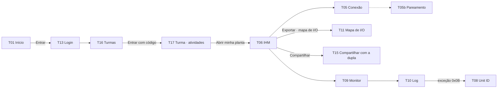
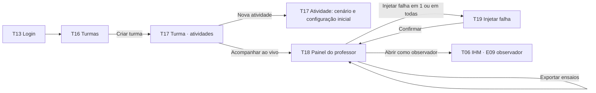
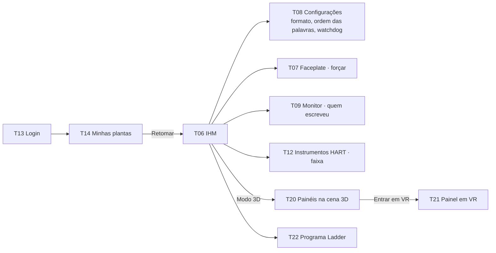

# Mapa de telas e fluxos

Etapa D1, parte A. Lista todas as telas do IndustrialSim Web (as que já existem e as das Fases 2 a 4), como se chega a cada uma e os fluxos dos perfis de `perfis-e-tarefas.md`. Cada tela tem um identificador (T01…) usado nos wireframes, no protótipo, no roteiro do teste e no relatório.

Critério da D1 ligado a este arquivo: "todas as telas do mapa existem no protótipo e cobrem os fluxos do visitante, do aluno e do professor". A coluna "Prancha" traz o arquivo da prancha nos wireframes (`wf:`, parte B) e, depois, no protótipo (`pt:`, parte D); a correspondência é conferida por script na parte F. Links dos canvases em `README.md`.

## Inventário das telas atuais (Etapas 7 e 8)

Hoje a navegação é mínima, pelo caminho da URL (`web/src/ui/navigation.ts`), e as seções da planta ficam no fragmento (`#process`, `#communication`, `#monitor`, `#log`). Observações feitas por inspeção das telas (capturas em `docs/validacao/img/etapa-07-*` e `etapa-08-*`); não são resultados de teste, e o teste da parte E vai confirmá-las ou não.

| Tela atual | Rota | Conteúdo | Observações para o redesenho |
| --- | --- | --- | --- |
| Início | `/` | Título, escolha de cenário (`ScenarioPicker`), estado do servidor (`HealthStatus`: versão e hora). | Não diz o que é o site nem como funciona; o estado do servidor é informação de desenvolvimento (vai para o rodapé ou "Sobre"). |
| Planta · Processo | `/plants/{id}#process` | Barra com nome, chip "Conectado", situação, tempo simulado, reinícios e cinco botões de mesmo peso (ensaio CSV, mapa CSV, mapa PDF, pausar, reiniciar). Sinóptico SVG, tendências; à direita, valores forçados, mestre Modbus, alarmes, distúrbios. | "Conectado" (navegador) e "Mestre conectado" se confundem; exportações com o mesmo peso de pausar e reiniciar; alarmes abaixo de outros painéis, às vezes fora da tela; IP, porta e Unit ID aparecem aqui e de novo em Comunicação; reiniciar usa o `confirm` do navegador. |
| Planta · Comunicação | `#communication` | Configurações (IP e porta só leitura, Unit ID, formato, ordem das palavras, watchdog, diagnóstico, mestres permitidos; Aplicar e Desfazer) e Mestres e conexões (estatísticas, IPs autorizados com Retirar, conexões abertas). | Junta "como ligo meu mestre" (pareamento, IPs) e "como a planta se comporta" (formato, watchdog). A tarefa T3 testa se as pessoas acham o formato aqui. |
| Planta · Monitor | `#monitor` | Tabela por área (coils, entradas discretas, holding e input registers, bloco de diagnóstico), com endereço (base 0 ou clássica), sinal, bruto, engenharia, última escrita e forçar. | Denso e útil para o PRF; os controles de forçar ocupam muito espaço em todas as linhas; não há filtro nem destaque da linha recém-escrita. |
| Planta · Log | `#log` | Tabela de eventos (horário, evento, autor), com contagem de repetidos. | Sem filtro por tipo; exceções Modbus não se destacam de eventos normais. |
| Diálogo de pareamento | (sobre a planta) | "Aceitar conexão de {IP}?", prazo, Aceitar e Recusar; aviso no modo um por vez. | Funciona; falta dizer de onde o pedido vem (porta, quando chegou) e como achar o próprio IP. |
| Mapa de I/O | `/plants/{id}/io-map` | Tabela para imprimir ou salvar em PDF, no formato atual. | Mantém a função; ganha cabeçalho com a identidade visual. |

## Modelo de navegação proposto

*(Revisto em 23/11/2026, a pedido do autor: abas como no navegador e planta sem barra global.)*

Fora e dentro de uma planta a navegação muda, para a planta ocupar a tela:

1. **Fora da planta: barra global** (início, cenários, minhas plantas, turmas, login): logotipo (volta ao início), Cenários, Minhas plantas, Turmas, Ajuda (guias de mestres), idioma, tema claro ou escuro, conta (ou "Entrar" para o visitante). O visitante vê "Cenários", "Ajuda" e "Entrar".
2. **Dentro da planta: sem barra global.** No lugar dela, uma faixa de abas como a do navegador:
   - **⌂** sai da planta para Minhas plantas (visitante: início).
   - **Nome da planta ▾** abre o menu da planta (T24): Minhas plantas, abrir outra planta, turmas, renomear, ajuda, idioma, tema e conta. Avisa que sair não desliga a planta.
   - **Abas:** Processo fica fixa (não fecha); as outras ferramentas abrem em abas que se fecham (×) e se reordenam (arrastar).
   - **+** abre o menu de nova aba (T23), com busca e um clique por ferramenta: Gráficos (T25), Conexão, Configurações, Monitor, Log, Mapa de I/O (abre a página de impressão), detalhe de cada instrumento, Configurador HART (Fase 3), Programa Ladder (Fase 4). Ferramenta já aberta: o clique vai para a aba dela.
   - As abas abertas ficam lembradas por planta, só neste navegador.
3. **Barra de estado da planta** (logo abaixo das abas, sempre visível em qualquer aba): **estado do mestre** em destaque (nenhum, aguardando pareamento, conectado, com erro), situação (rodando, pausada), tempo simulado, alarmes ativos, Pausar ou Retomar, Reiniciar, menu Exportar (ensaio CSV, mapa de I/O CSV e PDF), Compartilhar (com conta) e, para o visitante, o tempo restante. O estado do WebSocket do navegador só aparece quando há problema (reconectando, incompatível).

A cena 3D (Fase 3) é um modo de visualização da aba Processo, não uma aba à parte.

**Por que um clique e não duplo clique no menu de nova aba:** o duplo clique é difícil de descobrir, não existe em tela de toque e exige uma alternativa de teclado de qualquer forma (WCAG 2.1.1). Abrir com um clique segue a página de nova aba dos navegadores. O teste (parte E) confirma se as pessoas encontram as ferramentas pelo +.

As rotas seguem o padrão atual (`/plants/{id}`, aba ativa no fragmento, ex.: `#monitor`), para que o Voltar do navegador funcione e a D2 mude o mínimo de código.

## Telas

Fidelidade no protótipo: **A** alta (identidade visual, dados realistas, interação nos fluxos do teste), **M** média (estrutura e conteúdo reais, poucos detalhes visuais). Nível ISA-101: hierarquia de telas da IHM (1 visão geral de várias unidades; 2 uma unidade de processo; 3 detalhe de um equipamento ou instrumento; 4 diagnóstico), segundo Hollifield et al., *The High Performance HMI Handbook* (2008), que segue a ANSI/ISA-101.01-2015. Só se aplica às telas de operação.

| ID | Tela | Rota proposta | Etapa que implementa | Perfis | ISA-101 | Fid. | Hoje | Prancha |
| --- | --- | --- | --- | --- | --- | --- | --- | --- |
| T01 | Página inicial | `/` | D2 | VIS, ALU, PRO, PRF | — | A | parcial | wf: `Main` · pt: `Main` |
| T02 | Menu principal (barra global e menu da conta) | todas | D2 | todos | — | A | não | wf: `T02-Menu` · pt: `T02-Menu` |
| T03 | Seleção de cenários | `/scenarios` | D2 | VIS, ALU, PRF | — | A | parcial | wf: `T03-Cenarios` · pt: `T03-Cenarios` |
| T04 | Criar e abrir planta (diálogo, "abrindo…", erros) | `/scenarios` | D2 (Etapa 10 para salvar) | VIS, ALU, PRF | — | A | parcial | wf: `T04-CriarPlanta` · pt: `T04-CriarPlanta` |
| T05 | Conexão do mestre (dados, guias, mestres autorizados, conexões) | `/plants/{id}#connection` | D2 | VIS, ALU, PRF | 4 | A | parcial | wf: `T05-Conexao` · pt: `T05-Conexao` |
| T05b | Diálogo de pareamento | sobre a planta | D2 | VIS, ALU, PRF | — | A | sim | wf: `T05b-Pareamento` · pt: `T05b-Pareamento` |
| T06 | IHM · Processo (sinóptico, alarmes, tendências, distúrbios) | `/plants/{id}#process` | D2 | todos | 2 | A | sim | wf: `T06-IHM` · pt: `T06-IHM` |
| T07 | Detalhe de instrumento (faceplate: PV, mA, faixa, forçar, tendência) | painel lateral em T06 | D2 | ALU, PRF | 3 | A | não | wf: `T07-Faceplate` · pt: `T07-Faceplate` |
| T08 | Configurações da planta | `/plants/{id}#settings` | D2 | ALU, PRO, PRF | 4 | A | sim (em Comunicação) | wf: `T08-Configuracoes` · pt: `T08-Configuracoes` |
| T09 | Monitor de registradores | `/plants/{id}#monitor` | D2 | ALU, PRF | 4 | A | sim | wf: `T09-Monitor` · pt: `T09-Monitor` |
| T10 | Log de comunicação | `/plants/{id}#log` | D2 | ALU, PRF | 4 | A | sim | wf: `T10-Log` · pt: `T10-Log` |
| T11 | Mapa de I/O (impressão e PDF) | `/plants/{id}/io-map` | D2 | ALU, PRF | — | M | sim | wf: `T11-MapaIO` · pt: `T11-MapaIO` |
| T12 | Configurador HART (instrumentos, parâmetros, quadros, ponte PACTware) | `/plants/{id}#instruments` | 17, 18 | PRF, ALU | 4 | M | não | wf: `T12-HART` · pt: `T12-HART` |
| T13 | Entrar e criar conta (e-mail, Google, Microsoft, GitHub; continuar como visitante) | `/login` | 10 | ALU, PRO, PRF | — | A | não | wf: `T13-Entrar` · pt: `T13-Entrar` |
| T14 | Minhas plantas | `/plants` | 10 | ALU, PRO, PRF | — | A | não | wf: `T14-MinhasPlantas` · pt: `T14-MinhasPlantas` |
| T15 | Compartilhar planta (e-mail ou código de 1 uso ou vários, com validade; pessoas com acesso; sem papéis) | diálogo sobre T06 ou T14 | 11 | ALU, PRF | — | A | não | wf: `T15-Compartilhar` · pt: `T15-Compartilhar` |
| T16 | Turmas (minhas turmas, criar, entrar com código de turma ou de planta) | `/classes` | 12 | ALU, PRO | — | A | não | wf: `T16-Turmas` · pt: `T16-Turmas` |
| T17 | Turma e atividades (professor cria; aluno abre a planta da atividade) | `/classes/{id}` | 12 | ALU, PRO | — | A | não | wf: `T17-Turma` · pt: `T17-Turma` |
| T18 | Painel do professor (plantas da turma ao vivo) | `/classes/{id}/live` | 12 | PRO | 1 | A | não | wf: `T18-Painel` · pt: `T18-Painel` |
| T19 | Injetar falha ou distúrbio (diálogo, em uma ou em todas as plantas) | diálogo sobre T18 ou T06 | 12 (falhas: 16) | PRO, ALU | — | A | não | wf: `T19-InjetarFalha` · pt: `T19-InjetarFalha` |
| T20 | Painéis sobre a cena 3D (HUD: faceplate do instrumento apontado, alarmes, menu) | `/plants/{id}#process` (modo 3D) | 14 | todos | 2–3 | M | não | wf: `T20-Cena3D` · pt: `T20-Cena3D` |
| T21 | Painel em VR (menu de pulso e faceplate flutuante) | sessão WebXR | 19 | todos | 3 | M | não | wf: `T21-VR` · pt: `T21-VR` |
| T22 | Editor Ladder (esboço) | `/plants/{id}#program` | 22 | PRF, ALU | — | M | não | wf: `T22-Ladder` · pt: `T22-Ladder` |
| T23 | Nova aba (menu do +: abrir ferramenta ou instrumento) | sobre a planta | D2 | todos | — | A | não | wf: `T23-NovaAba` · pt: `T23-NovaAba` |
| T24 | Menu da planta (sair, outras plantas, turmas, idioma, tema, conta) | sobre a planta | D2 | todos | — | A | não | wf: `T24-MenuPlanta` · pt: `T24-MenuPlanta` |
| T25 | Gráficos (tendências grandes: vários gráficos, escolha de sinais, janela até toda a sessão, zoom, cursor, marcas de eventos, exportar trecho) | `/plants/{id}#trends` | D2 | todos | 2–4 | A | parcial (tendência pequena em Processo) | wf: `T25-Graficos` · pt: `T25-Graficos` |

Fora do mapa por ora (sem tela própria na D1): conta e privacidade (exportar e excluir conta, LGPD, Etapas 10 e 13), termos de uso, editor FBD (Etapa 23, segue o modelo do T22), reprodução de ensaio gravado (entra como ação em T14 ou T06 quando a etapa existir).

## Estados especiais

Estados que mudam uma tela sem criar outra. Entram no protótipo como variantes das telas indicadas.

| ID | Estado | Telas | Como aparece |
| --- | --- | --- | --- |
| E01 | Sem mestre conectado | T06, T05 | Faixa na IHM com IP, porta e Unit ID e o link "Como conectar meu mestre"; estado vazio em T05 com os guias. |
| E02 | Pedido de pareamento pendente | todas da planta | Diálogo T05b; se fechado sem responder, aviso persistente na barra da planta até o prazo. |
| E03 | Alarme ativo (inclui watchdog disparado) | T06, T18, T20 | Banda de alarmes no topo da IHM; símbolo e cor de prioridade no sinóptico; contagem na barra da planta. |
| E04 | Valor forçado | T06, T07, T09 | Marca "FORÇADO" no valor (cor própria de estado anormal + texto), lista de forçados com Liberar. |
| E05 | Planta pausada | T06, T09, T18 | Faixa explicando que o mestre continua rodando; controles de distúrbio continuam, o tempo simulado para. |
| E06 | Reconectando / versão incompatível / planta encerrada ou expirada | todas da planta | Faixa de aviso (reconectando) ou tela de erro com a ação certa (recarregar, abrir outra planta). |
| E07 | Servidor lotado / sem porta Modbus livre | T04 | Erro no diálogo, com o que fazer (tentar de novo em minutos). |
| E08 | Visitante perto do limite de 60 min | barra da planta | Tempo restante sempre visível; aviso aos 10 min, com convite para criar conta. |
| E09 | Professor observando (sem permissão de comando) | T06, T08, T09 | Controles desabilitados com o motivo ("Você está observando esta planta"). Só acontece pelo painel da turma (ver pergunta 9). |
| E10 | Falha de instrumento injetada | T06, T07, T18 | Valor na corrente de falha NAMUR (3,6 ou 21 mA), marcado como falha; o professor sempre vê, o aluno só se o professor escolher avisar (T19). |

Pranchas dos estados nos wireframes: E01 e E08 em `E01-SemMestre`; E02 em `T05b-Pareamento`; E03, E04 e E10 em `EA-Alarme`; E05 e E09 em `EB-Pausada`; E06 em `EC-Avisos`; E07 em `T04-CriarPlanta`.

Pranchas dos estados no protótipo: E01 em `E01-SemMestre`; E02 em `T05b-Pareamento`; E03, E04 e E10 em `EA-Alarme` e `T06-Escuro` (E10 também em `T18-Painel`, depois de injetar a falha); E05 e E09 em `EB-Pausada`; E06 e E08 em `EC-Avisos` (um seletor no topo troca o aviso); E07 em `T04-CriarPlanta` (ajuste `estado`).

## Perguntas abertas (wireframes)

Decisões de interface que os wireframes propõem e que a revisão (fim da parte B) ou o teste (parte E) precisam confirmar:

1. **Sem mestre:** a IHM mostra uma faixa com IP, porta e Unit ID (E01). Basta, ou a planta deveria abrir direto na aba Conexão?
2. **Pedido de pareamento:** diálogo modal; se a pessoa fechar sem responder, a barra da planta mantém o aviso até o prazo de 60 s (D38).
3. **Comunicação dividida em Conexão e Configurações**, abertas pelo + (T23): a tarefa T3 mede se as pessoas acham o formato analógico sem ver as seções listadas na tela.
4. **Forçar** sai da linha do monitor (hoje um controle em cada linha) e vai para o menu da linha e para o faceplate (T07).
5. **Aviso ao aluno quando o professor injeta falha:** o padrão proposto é não avisar (o aluno diagnostica); o professor escolhe em T19.
6. **Prioridade de alarme:** a banda de alarmes (E03) mostra prioridade por forma e número, mas a seção `hmi.alarms` do cenário (D39) ainda não tem prioridade. Se a ideia ficar, a D2 ou a Etapa 15 acrescenta o campo ao `scenario.json` (decisão nova).
7. **Pausar e Reiniciar** ficam na barra da planta; as exportações (ensaio CSV, mapa de I/O CSV e PDF) vão para um menu "Exportar".
8. **Comandos do mestre:** saíram do painel próprio, para sobrar espaço à planta (revisão de 23/11).
   - Primeiro iam ao sinóptico, ao lado da posição de cada válvula ("cmd do mestre 82,3 %").
   - Na conferência do protótipo (23/11), saíram também do sinóptico, porque a etiqueta cobria a tubulação.
   - Hoje o comando aparece no detalhe do instrumento (T07), no monitor (T09, holding register com autor) e na aba Gráficos (T25, "FV-101 cmd" e "pos").
9. **Compartilhamento sem papéis** (revisão de 23/11, pedido do autor): quem recebe o convite tem os mesmos direitos de quem compartilhou; só quem criou a planta a exclui e remove pessoas. O acesso só de leitura fica para o professor que observa a planta de um aluno pela turma. *(As duas regras foram confirmadas pelo autor em 23/11/2026.)* **Contraria a D15 e o RF09** (papéis dono, operador e observador) e a tabela "Compartilhamento" do descritivo; a decisão nova é registrada no descritivo ao fim da D1.
10. **Histórico dos gráficos (T25)** *(decidido pelo autor em 23/11/2026)*:
    - **Só a sessão atual.** Não há histórico de sessões anteriores. Quem entra na planta depois (outro aluno, o professor, a mesma pessoa reabrindo a página) vê o histórico desde o início da sessão, mandado pelo servidor ao conectar.
    - **Sessão (suposição a confirmar):** do momento em que a planta começa a rodar (criada ou retomada da hibernação) até ela encerrar ou hibernar. O reinício da planta zera o histórico, como já zera a tendência (D41).
    - **Implementação, para a D2 ou a etapa que fizer o servidor guardar o histórico:**
      - o servidor guarda o histórico em memória, por planta;
      - para caber no PC do laboratório (RNF07), os últimos minutos ficam a 20 Hz e o resto é reduzido (por exemplo, a 1 Hz). A 1 Hz e 16 sinais `float32`, cerca de 230 kB por hora por planta;
      - o envio ao conectar e o formato da mensagem entram no protocolo WebSocket (D40).
    - Vira decisão nova no descritivo ao fim da D1.
11. **Código de acesso à planta**: gerado em T15, de 1 uso ou de vários usos, com validade e revogável; digitado em Minhas plantas ou Turmas, no mesmo campo que aceita código de turma, ou aberto como link.

## Fluxos

### Visitante: do início ao mestre controlando a planta (T1, T2, T3)

```mermaid
flowchart LR
  T01[T01 Início] -->|Experimentar sem conta| T03[T03 Cenários]
  T03 -->|Abrir planta| T04[T04 Criar planta]
  T04 -->|abrindo…| T06[T06 IHM · Processo<br/>E01 sem mestre]
  T06 -->|faixa: abrir a aba Conexão| T05[T05 Conexão<br/>IP, porta, Unit ID, guias]
  T05 -.->|o mestre conecta| T05b[T05b Pareamento]
  T05b -->|Aceitar| T06b[T06 IHM · mestre conectado]
  T06b -->|+ nova aba| T23[T23 Nova aba]
  T23 -->|Configurações| T08[T08 Formato analógico]
  T08 -->|Aplicar| T10[T10 Log mostra a mudança]
  T04 -.->|E07 servidor lotado| T03
```



### Aluno: da turma à planta da atividade, com a dupla (S8, T2, T4, S1, S5)



### Professor: atividade, acompanhamento e falha (S12, T5, S13)



### Profissional: planta salva, diagnóstico e HART (S9, T3, S3, S4, S10)



## Textos novos

Os textos das telas novas ainda não existem nos arquivos de idioma. Na parte D, cada texto novo do protótipo ganha aqui uma chave proposta (no mesmo formato de `web/src/locales/pt-BR/translation.json`), para a D2 levar aos arquivos de idioma sem inventar nomes de novo.

**Como esta lista foi feita (23/11/2026).**

- **Origem:** um script extraiu os textos visíveis das pranchas de alta fidelidade (conteúdo, `aria-label`, `placeholder`, `title` e textos montados em código) e comparou com o `translation.json` atual. Deram 647 textos novos e 99 que já existem. Os 647 viraram 475 chaves, porque muitos se repetem entre telas, outros são dado fictício e as variações de número ficam numa chave só com interpolação.
- **O que ficou de fora:** dados fictícios (nomes, IPs, códigos, valores medidos), classes CSS e textos que só explicam o protótipo a quem o revisa (por exemplo "Sinóptico resumido…" e o seletor de avisos da prancha EC).
- **Formato:** interpolação no formato do i18next (`{{name}}`), plural com `_one` e `_other` (i18next 27.1.1, versão do `web/package.json`). Marcação dentro do texto em `<tag>` para o componente `Trans`.
- **Telas de fidelidade média (T12, T20, T21, T22):** não entram aqui. Os textos delas mudam nas etapas que as implementam (14, 17 e 18, 19, 22), e as chaves nascem lá.
- **Textos do cenário** (tags de malha, resumo de I/O): seguem o padrão já usado em `scenarios.names.caldeira`, com o id do cenário na chave.

### Mudanças em chaves que já existem

| Chave atual | Proposta | Motivo |
| --- | --- | --- |
| `plant.tabs.communication` | Remover; entram `plant.tabs.trends`, `.connection`, `.settings`, `.instruments`, `.program` | A aba Comunicação virou Conexão e Configurações (navegação por abas) |
| `plant.tabsLabel` ("Seções da planta") | "Abas da planta" | Nome usado no protótipo, que combina com o modelo de abas |
| `plant.restart` ("Reiniciar planta") | "Reiniciar…" | As reticências indicam que a ação pede confirmação (`plant.restartConfirm`) |
| `settings.heading` ("Configurações de comunicação") | "Configurações" | É o nome da aba |
| `settings.watchdogTimeout` ("Tempo limite (s)") | "Tempo limite" | A unidade passa para o lado do campo |
| `trends.window` ("Últimos {{seconds}} s, em % da faixa de cada instrumento") | "em % da faixa · últimos {{minutes}} min" | Texto da faixa de tendências da T06 |
| `masters.revoke` ("Retirar") | "Retirar…" | Pede confirmação (`masters.revokeConfirm`) |
| `ioMap.access.read` / `.write` ("Leitura" / "Escrita") | "lê" / "escreve", sob a coluna `ioMap.columns.master` ("Mestre") | Deixa claro quem lê e quem escreve; `ioMap.columns.access` sai |
| `ioMap.columns.raw` ("Bruto (4–20 mA)") | "Bruto" | O formato aparece no cabeçalho do mapa |

### Chaves novas

```json
{
  "common": {
    "close": "Fechar",
    "cancel": "Cancelar",
    "back": "Voltar",
    "copy": "Copiar",
    "edit": "Editar",
    "remove": "Remover",
    "tryAgain": "Tentar de novo",
    "notNow": "Agora não",
    "actions": "Ações",
    "breadcrumb": "Caminho",
    "defaultTag": "padrão"
  },
  "nav": {
    "label": "Menu principal",
    "homeLink": "IndustrialSim Web, página inicial",
    "scenarios": "Cenários",
    "myPlants": "Minhas plantas",
    "classes": "Turmas",
    "help": "Ajuda e guias",
    "signIn": "Entrar",
    "language": "Idioma: {{language}}",
    "themeDark": "Tema escuro",
    "themeLight": "Tema claro",
    "account": "Conta de {{name}}",
    "accountMenu": "Conta",
    "privacy": "Conta e privacidade",
    "signOut": "Sair",
    "openMenu": "Abrir menu",
    "closeMenu": "Fechar menu"
  },
  "home": {
    "eyebrow": "Simulador de processo contínuo · ensino e pesquisa",
    "heading": "Uma planta industrial no navegador, controlada pelo seu CLP",
    "intro": "Abra uma caldeira que roda no servidor e controle-a com qualquer mestre Modbus TCP: CLP real, CODESYS, OpenPLC, SCADA ou um script. Nada para instalar.",
    "tryWithoutAccount": "Experimentar sem conta",
    "signInOrSignUp": "Entrar ou criar conta",
    "visitorLimit": "Sem conta, a planta dura até 60 minutos e não é salva.",
    "liveSynoptic": "Sinóptico da caldeira com valores ao vivo",
    "howItWorks": "Como funciona",
    "steps": {
      "open": { "title": "1. Abra uma planta", "text": "Escolha um cenário. A física roda no servidor a cada 10 ms; a planta não tem controle próprio." },
      "connect": { "title": "2. Conecte seu mestre", "text": "Configure no seu mestre o servidor, a porta e o Unit ID que a planta mostra, e aceite o pedido de conexão." },
      "control": { "title": "3. Controle e observe", "text": "Feche as malhas no seu programa, provoque distúrbios e acompanhe gráficos, alarmes e registradores." }
    },
    "scenariosHeading": "Cenários",
    "worksWith": "Funciona com o mestre que você já usa",
    "guidesLink": "Guias de conexão passo a passo",
    "teachers": {
      "heading": "Para professores",
      "text": "Crie uma turma, distribua plantas aos alunos, acompanhe todas ao vivo e injete falhas de instrumento.",
      "link": "Conhecer as turmas"
    },
    "footer": {
      "about": "Sobre o projeto",
      "guides": "Guias",
      "terms": "Termos de uso e privacidade",
      "status": "Projeto de iniciação científica · servidor no ar · versão {{version}}"
    }
  },
  "scenarios": {
    "viewIoMap": "Ver o mapa de I/O",
    "packagesNote": "Novos cenários entram como pacotes de arquivos (modelo 3D e descrição), sem mudar o site.",
    "tags": {
      "caldeira": {
        "loops": "Malhas LIC-101 e PIC-101",
        "advanced": "Avançado: nível a três elementos",
        "hart": "4 instrumentos HART"
      }
    },
    "ioSummary": {
      "caldeira": {
        "coil": "bomba",
        "discrete-input": "chaves e estados",
        "holding-register": "válvulas e heartbeat",
        "input-register": "medições e diagnóstico"
      }
    }
  },
  "createPlant": {
    "visitorNotice": "Como visitante, a planta dura até <strong>60 minutos</strong> e não é salva. <link>Entre</link> para salvar e compartilhar.",
    "communication": "Comunicação com o mestre (pode mudar depois)",
    "opening": "Abrindo a planta…",
    "reservingPort": "Reservando uma porta Modbus no servidor.",
    "failedTitle": "Não foi possível abrir a planta",
    "backToScenarios": "Voltar aos cenários"
  },
  "plantBar": {
    "leaveVisitor": "Sair da planta para o início",
    "leaveMember": "Sair da planta para Minhas plantas",
    "menu": "Menu da planta",
    "temporaryName": "{{scenario}} (temporária)",
    "scenarioPort": "{{scenario}} · porta Modbus {{port}}",
    "openOther": "Abrir outra planta…",
    "rename": "Renomear planta",
    "signInToSave": "Entrar para salvar esta planta",
    "themeValue": "Tema: {{theme}}",
    "themes": { "auto": "automático", "light": "claro", "dark": "escuro" },
    "leaveVisitorHint": "Planta temporária: sem ninguém nem mestre conectado, encerra em 30 minutos; no máximo 60 minutos no total.",
    "leaveMemberHint": "Sair da planta não a desliga: sem ninguém nem mestre conectado, ela hiberna em 30 minutos.",
    "newTab": "Abrir nova aba",
    "closeTab": "Fechar a aba {{name}}",
    "visitorTimeLeft": "Visitante · {{minutes}} min restantes",
    "observing": "Observando (turma)",
    "export": "Exportar",
    "share": "Compartilhar",
    "alarmsActive": "Alarmes ativos: {{count}}",
    "noAlarms": "Sem alarmes",
    "masterConnectedAddress": "Mestre conectado · {{address}}",
    "masterPending": "Pedido de conexão de {{address}}",
    "masterErrors": "Mestre com exceções Modbus",
    "pausedMark": "PAUSADA"
  },
  "launcher": {
    "title": "Abrir em nova aba",
    "escHint": "Esc fecha",
    "searchLabel": "Buscar ferramenta ou instrumento",
    "searchPlaceholder": "Buscar: formato, monitor, LT-101…",
    "groupTools": "Processo e comunicação",
    "groupInstruments": "Instrumentos",
    "openBadge": "aberta",
    "footer": "Um clique abre a ferramenta numa aba (ou vai para ela, se já estiver aberta). As abas ficam lembradas neste navegador.",
    "tools": {
      "trends": { "name": "Gráficos", "description": "Tendências grandes, vários gráficos, zoom" },
      "connection": { "name": "Conexão", "description": "IP, porta, Unit ID, guias e mestres" },
      "settings": { "name": "Configurações", "description": "Formato analógico, Unit ID, watchdog" },
      "monitor": { "name": "Monitor", "description": "Registradores ao vivo e quem escreveu" },
      "log": { "name": "Log", "description": "Conexões, pareamentos, exceções, mudanças" },
      "ioMap": { "name": "Mapa de I/O", "description": "Endereços e escalas para imprimir ou PDF" },
      "hart": { "name": "Configurador HART", "description": "Faixa, amortecimento, PACTware" },
      "ladder": { "name": "Programa Ladder", "description": "Soft-PLC no servidor" }
    }
  },
  "plant": {
    "tabs": {
      "trends": "Gráficos",
      "connection": "Conexão",
      "settings": "Configurações",
      "instruments": "Instrumentos HART",
      "program": "Programa"
    }
  },
  "hmi": {
    "noMaster": {
      "title": "Conecte seu mestre Modbus",
      "text": "A planta está rodando, mas nada a controla: ela não tem controle próprio.",
      "openConnection": "Abrir a aba Conexão (guias)",
      "guidesHint": "Guias para CODESYS, OpenPLC, TIA Portal (MB_CLIENT) e Python. Quando o mestre conectar, a página pede para você aceitar o IP dele."
    },
    "observing": {
      "title": "Você está observando esta planta",
      "text": "(aberta pelo painel da turma). Você vê tudo, mas não comanda: distúrbios, forçar, configurações, pausar e reiniciar ficam desabilitados."
    },
    "synopticHint": "Clique numa medição para ver o detalhe do instrumento",
    "view2d": "2D",
    "view3d": "3D",
    "running": "em operação",
    "faultMark": "FALHA",
    "disturbancesHint": "Vale no passo seguinte da simulação. Veja a resposta em Gráficos.",
    "forcedNone": "Nenhum. Para forçar, abra o detalhe de um instrumento.",
    "forcedToast": "{{signal}} forçado em {{value}}",
    "fault": {
      "title": "FALHA de instrumento · {{tag}}",
      "electronics": "Falha de eletrônica: corrente em {{current}} mA (NAMUR NE43); o mestre lê {{raw}}.",
      "openSensor": "Sensor aberto: corrente em {{current}} mA (NAMUR NE43); o mestre lê {{raw}}.",
      "injectedBy": "Injetada pelo professor às {{time}}."
    },
    "openTrendsTab": "Abrir na aba Gráficos",
    "copiedAddress": "Endereço do servidor copiado",
    "copiedPort": "Porta copiada"
  },
  "alarms": {
    "state": "ALARME",
    "list": "Alarmes",
    "priority": "Prioridade {{priority}}",
    "details": {
      "watchdog": "FV-101 aberta, FV-102 fechada",
      "forcedSource": "{{signal}} está forçado"
    }
  },
  "synoptic": {
    "caldeira": {
      "shortLabels": {
        "LT-101": "nível",
        "PT-101": "pressão",
        "FT-101": "água",
        "FT-102": "vapor",
        "FV-103": "carga"
      }
    }
  },
  "faceplate": {
    "close": "Fechar detalhe",
    "transmitter": {
      "level": "Transmissor de nível · HART",
      "pressure": "Transmissor de pressão · HART",
      "flow": "Transmissor de vazão · HART"
    },
    "percentOfRange": "% da faixa",
    "current": "Corrente",
    "modbusValue": "Valor no Modbus",
    "range": "Faixa (LRV–URV)",
    "damping": "Amortecimento",
    "forceHeading": "Forçar valor",
    "forceHint": "O mestre passa a ler este valor no lugar da medição, até você liberar.",
    "viewInMonitor": "Ver no monitor",
    "openHart": "Configurador HART",
    "openChart": "Gráfico"
  },
  "share": {
    "title": "Compartilhar “{{plant}}”",
    "intro": "Quem entra pode fazer o mesmo que você: operar, parear mestres, configurar e compartilhar.",
    "inviteLabel": "Convidar por e-mail",
    "invitePlaceholder": "e-mail de quem já tem conta",
    "invite": "Convidar",
    "invited": "Convite enviado",
    "byCode": "Ou por código",
    "usesLegend": "Quantas vezes o código pode ser usado",
    "usesLabel": "Pode ser usado",
    "usesOne": "1 vez",
    "usesMany": "várias vezes",
    "validity": "Validade",
    "validities": { "24h": "24 horas", "7d": "7 dias", "revoked": "Até eu revogar" },
    "generate": "Gerar código",
    "copyCode": "Copiar código",
    "copyLink": "Copiar link",
    "codeCopied": "Código copiado",
    "linkCopied": "Link copiado",
    "codeInfoOne": "1 uso · expira {{when}}",
    "codeInfoMany": "vários usos · expira {{when}}",
    "codeHelp": "O colega digita o código em Minhas plantas › Tem um código?, ou abre o link.",
    "people": "Pessoas com acesso",
    "you": "Você",
    "creator": "criou a planta",
    "invitePending": "convite enviado"
  },
  "connection": {
    "dataHeading": "Dados para configurar no seu mestre",
    "changeInSettings": "Mudar em Configurações",
    "addressingHint": "Endereços em base 0 (CODESYS, OpenPLC, pymodbus) ou na notação clássica (MB_CLIENT e muitos SCADAs: coil 0 = 1, input register 0 = 30001).",
    "howToConnect": "Como conectar",
    "chooseMaster": "Escolha o seu mestre",
    "guideLink": "Guia completo: {{name}}",
    "guides": {
      "codesys": {
        "name": "CODESYS",
        "step1": "No dispositivo Ethernet, adicione um Modbus TCP Client (“Master” antes da V3.5 SP22) e marque Reconexão automática.",
        "step2": "Embaixo dele, adicione um Modbus TCP Server com o IP {{address}} e a porta {{port}}; o Unit-ID ({{unitId}}) fica na aba de parâmetros.",
        "step3": "Crie os canais em base 0: Read Input Registers 0 a 5, Write Single Register 0 e 10, Write Single Coil 0.",
        "step4": "Baixe e rode o programa. Nesta página, aceite o pedido de conexão do seu IP."
      },
      "openplc": {
        "name": "OpenPLC",
        "step1": "No OpenPLC Editor, crie um Remote Device com protocolo Modbus, transporte TCP/IP.",
        "step2": "Use o IP {{address}}, a porta {{port}} e o Slave ID {{unitId}}.",
        "step3": "Em IO Tag Mapping, leia os input registers 0 a 5 (função 4) e escreva o holding register 0, o 10 e o coil 0.",
        "step4": "Rode no OpenPLC Runtime v4 (o Simulator do Editor não abre conexões TCP) e aceite o pedido nesta página."
      },
      "tia": {
        "name": "TIA Portal · MB_CLIENT",
        "step1": "Crie uma variável TCON_IP_v4 com o IP {{address}} e a porta {{port}} para cada MB_CLIENT.",
        "step2": "O MB_CLIENT usa o Unit ID 255 por padrão: ponha MB_UNIT_ID := {{unitId}} no DB de instância, ou mude o Unit ID da planta para 255 em Configurações.",
        "step3": "Endereços na notação clássica: input registers a partir de 30001, holding registers a partir de 40001.",
        "step4": "Baixe o programa e aceite o pedido de conexão nesta página."
      },
      "python": {
        "name": "Python · pymodbus",
        "step1": "Instale o pymodbus e crie um ModbusTcpClient para {{address}}, porta {{port}}.",
        "step2": "Leia os input registers 0 a 5 e escreva o holding register 0 (FV-101) e o 10 (heartbeat), com device_id={{unitId}} (slave={{unitId}} antes da versão 3.10).",
        "step3": "Rode o script e aceite o pedido de conexão nesta página."
      }
    },
    "masterMode": "Modo: {{mode}} · <link>mudar</link>",
    "columns": { "ip": "IP", "since": "Desde", "origin": "Origem", "requestsPerSecond": "Req/s", "exceptions": "Exceções" },
    "served": "Requisições atendidas: {{count}}",
    "waitingTitle": "Aguardando o seu mestre",
    "waitingText": "Nenhuma conexão ainda. Quando o mestre conectar, aparece aqui um pedido para você aceitar.",
    "refusedNotice": "Você recusou {{address}}. Ele fica bloqueado por {{seconds}} s.",
    "troubleshootTitle": "Não conecta?",
    "troubleshootText": "O pedido não apareceu: confira o IP e a porta, e se a rede libera a porta {{port}}. Mestre conectado mas sem dados: veja as exceções no <link>log</link> (Unit ID errado aparece como exceção 11)."
  },
  "pairing": {
    "portLabel": "Porta da planta",
    "arrivedAt": "Chegou às",
    "closesIn": "Fecha sozinho em",
    "ipHelp": "Não sabe o IP do seu mestre? É o IP público da rede onde ele está; em caso de dúvida, recuse e veja o log.",
    "refusedToast": "Conexão de {{address}} recusada"
  },
  "settings": {
    "formatHint": "Como o mestre lê as medições e escreve os comandos analógicos. Escolha o formato do cartão ou do controlador que você usa.",
    "formatExample": "{{signal}} em {{value}} chega ao mestre como <strong>{{raw}}</strong>",
    "float32Extra": " em 2 registradores ({{first}}–{{last}}); cada sinal passa a ocupar 2",
    "unitIdHint": "Requisições com outro Unit ID recebem a exceção 11. O MB_CLIENT da Siemens usa 255 por padrão.",
    "unitIdLabel": "Unit ID da planta",
    "unitIdRange": "de 1 a 255",
    "watchdogHint": "Se o heartbeat (holding register 10) ficar parado, a planta vai ao estado seguro: FV-101 abre e FV-102 fecha.",
    "diagnosticsHint": "Input registers 100 a 109 com nível, pressão, vazões e FV-103 em unidades de engenharia. Desligue em avaliações.",
    "pendingRegion": "Alterações não aplicadas",
    "pending_one": "{{count}} alteração não aplicada",
    "pending_other": "{{count}} alterações não aplicadas",
    "pendingChange": "{{setting}}: {{old}} → {{new}}",
    "applied": "{{setting}} aplicado: {{value}}.",
    "appliedHint": "O mestre já lê no formato novo.",
    "viewInLog": "Ver no log"
  },
  "monitor": {
    "notationShort": "Notação",
    "searchLabel": "Buscar sinal",
    "searchPlaceholder": "Buscar tag ou sinal",
    "highlightRecent": "Destacar escritas recentes",
    "rate": "Atualiza {{count}} vezes por segundo",
    "direction": { "write": "o mestre escreve", "read": "o mestre lê" },
    "now": "agora",
    "rowActions": "Ações da linha",
    "forceValueMenu": "Forçar valor…",
    "openDetail": "Abrir detalhe",
    "viewInChart": "Ver no gráfico"
  },
  "log": {
    "filtersLabel": "Filtrar eventos",
    "filters": {
      "all": "Todos",
      "connections": "Conexões",
      "pairing": "Pareamento",
      "exceptions": "Exceções Modbus · {{count}}",
      "settings": "Configuração",
      "plant": "Planta"
    },
    "window": "Últimos {{count}} eventos · os novos entram no topo",
    "exceptionMark": "EXCEÇÃO",
    "kinds": { "plant-created": "Planta criada a partir do cenário {{scenario}}." }
  },
  "charts": {
    "controls": "Controles dos gráficos",
    "window": "Janela",
    "windowLabel": "Janela de tempo",
    "windows": { "minutes": "{{count}} min", "session": "Toda a sessão" },
    "scale": "Escala",
    "percentOfRange": "% da faixa",
    "engineering": "Engenharia",
    "freeze": "Congelar",
    "zoomIn": "Aproximar",
    "zoomOut": "Afastar",
    "addChart": "Gráfico",
    "exportRange": "Exportar trecho (CSV)",
    "signals": "Sinais",
    "groups": {
      "measurements": "Medições",
      "valvePositions": "Válvulas: posição",
      "masterCommands": "Comandos do mestre",
      "discrete": "Discretos"
    },
    "legendHint": "As linhas diferem pela cor e pelo traço. Histórico desde o início desta sessão da planta.",
    "chartOptions": "Opções do gráfico {{name}}",
    "presets": {
      "level": { "title": "Malha de nível", "subtitle": "LT-101 · FV-101 comando e posição · FT-102" },
      "pressure": { "title": "Malha de pressão", "subtitle": "PT-101 · FV-103 · faixa normal ao fundo" }
    },
    "command": "cmd",
    "position": "pos",
    "axisMinutesAgo": "−{{count}} min",
    "axisNow": "agora",
    "cursorTime": "t = {{time}} s",
    "marksHint": "Marcas no eixo do tempo: distúrbios, pausas, reinícios, valores forçados e mudanças de configuração. Arraste para dar zoom num trecho, ou use os botões + e −."
  },
  "auth": {
    "tabsLabel": "Entrar ou criar conta",
    "signIn": "Entrar",
    "signUp": "Criar conta",
    "intro": "Com conta, suas plantas ficam salvas, você compartilha com colegas e participa de turmas.",
    "continueWith": "Continuar com {{provider}}",
    "orEmail": "ou com e-mail",
    "displayName": "Nome de exibição",
    "displayNameHint": "Aparece para colegas e professores.",
    "email": "E-mail",
    "password": "Senha",
    "passwordHint": "Pelo menos {{count}} caracteres.",
    "forgotPassword": "Esqueci a senha",
    "continueAsVisitor": "Continuar como visitante",
    "visitorHint": "Uma planta temporária de até 60 minutos, sem salvar nem compartilhar.",
    "privacy": "Guardamos só o e-mail e o nome de exibição. <link>Termos de uso e política de privacidade</link>."
  },
  "myPlants": {
    "heading": "Minhas plantas",
    "haveCode": "Tem um código?",
    "codeForm": "Entrar com código",
    "codePlaceholder": "ex.: {{example}}",
    "enter": "Entrar",
    "newPlant": "Nova planta",
    "filtersLabel": "Filtrar plantas",
    "tabs": {
      "mine": "Minhas · {{count}}",
      "shared": "Compartilhadas comigo · {{count}}",
      "classes": "De turmas · {{count}}"
    },
    "columns": {
      "plant": "Planta",
      "status": "Situação",
      "master": "Mestre",
      "lastActivity": "Última atividade",
      "people": "Pessoas"
    },
    "status": { "hibernating": "Hibernando" },
    "masterNone": "Nenhum",
    "people": {
      "onlyYou": "só você",
      "youAndMore_one": "você e mais {{count}}",
      "youAndMore_other": "você e mais {{count}}",
      "pair": "dupla"
    },
    "open": "Abrir",
    "share": "Compartilhar",
    "moreActions": "Mais ações de {{plant}}",
    "actionsMenu": "Ações da planta",
    "rename": "Renomear",
    "replay": "Reproduzir ensaio",
    "ioMap": "Mapa de I/O",
    "delete": "Excluir planta…",
    "leave": "Sair desta planta",
    "codeHint": "O campo “Tem um código?” aceita código de planta (de um colega) e de turma.",
    "hibernateHint": "Plantas sem ninguém conectado hibernam depois de 30 minutos e voltam do mesmo estado ao abrir, na mesma porta Modbus quando possível."
  },
  "classes": {
    "heading": "Turmas",
    "create": "Criar turma",
    "teaching": "Turmas que leciono",
    "learning": "Turmas em que estou",
    "students_one": "{{count}} aluno",
    "students_other": "{{count}} alunos",
    "activities_one": "{{count}} atividade",
    "activities_other": "{{count}} atividades",
    "runningNow_one": "Agora: {{count}} planta rodando",
    "runningNow_other": "Agora: {{count}} plantas rodando",
    "withAlarm": "{{count}} com alarme",
    "noneRunning": "Nenhuma planta rodando",
    "joinLabel": "Entrar com código de turma ou de planta",
    "joinHint": "Ou abra o link que o professor mandou.",
    "notStudent": "Você ainda não está em nenhuma turma como aluno.",
    "createDialog": {
      "name": "Nome",
      "namePlaceholder": "ex.: {{example}}",
      "term": "Semestre",
      "hint": "Depois de criar, você recebe um código e um link de convite para os alunos."
    },
    "classCode": "Código da turma",
    "copyInvite": "Copiar link de convite",
    "inviteCopied": "Link de convite copiado.",
    "sectionsLabel": "Seções da turma",
    "sections": { "activities": "Atividades", "students": "Alunos · {{count}}", "trials": "Ensaios" },
    "activity": {
      "summary": "{{scenario}} · {{distribution}} · formato {{format}} · diagnóstico {{diagnostics}}",
      "perPair": "uma planta por dupla ({{count}})",
      "perStudent": "uma planta por aluno ({{count}})",
      "live": "Agora: {{running}} rodando · {{withMaster}} com mestre ·",
      "yourPair": "Sua dupla: {{pair}} (com {{partner}}) · disponível até {{date}}",
      "startsAt": "Começa em {{date}}",
      "initialFault": "falha inicial: {{fault}}",
      "followLive": "Acompanhar ao vivo",
      "openPairPlant": "Abrir a planta da dupla",
      "openMyPlant": "Abrir minha planta",
      "notAvailable": "Ainda não disponível"
    },
    "newActivity": {
      "heading": "Nova atividade",
      "name": "Nome",
      "scenario": "Cenário",
      "onePlantFor": "Uma planta para",
      "eachStudent": "cada aluno",
      "eachPair": "cada dupla ou equipe",
      "initialConfig": "Configuração inicial",
      "watchdogOn": "Watchdog ligado",
      "publishDiagnostics": "Publicar bloco de diagnóstico",
      "initialFault": "Falha inicial",
      "noFault": "Nenhuma",
      "availableFrom": "Disponível de",
      "availableUntil": "até",
      "datePlaceholder": "dd/mm/aaaa hh:mm",
      "create": "Criar atividade"
    }
  },
  "classPanel": {
    "title": "{{activity}} · ao vivo",
    "summary": "{{plants}} plantas · {{running}} rodando · {{withMaster}} com mestre · {{withAlarm}} com alarme",
    "summaryFaults": " · {{count}} com falha injetada",
    "injectAll": "Injetar em todas…",
    "exportTrials": "Exportar ensaios (CSV)",
    "order": "Anormais primeiro · atualiza a cada segundo",
    "filtersLabel": "Filtrar plantas",
    "filters": {
      "all": "Todas · {{count}}",
      "alarm": "Com alarme · {{count}}",
      "noMaster": "Sem mestre · {{count}}",
      "paused": "Pausadas · {{count}}",
      "fault": "Com falha injetada · {{count}}"
    },
    "tile": {
      "noMaster": "SEM MESTRE",
      "paused": "PAUSADA",
      "notOpened": "NÃO ABERTA",
      "notOpenedMaster": "Planta ainda não aberta",
      "master": "Mestre {{address}}",
      "masterNone": "Nenhum mestre",
      "fault": "FALHA · {{tag}}",
      "observe": "Observar",
      "inject": "Injetar falha…",
      "removeFault": "Remover falha",
      "faultRemoved": "Falha removida da {{plant}}."
    }
  },
  "inject": {
    "title": "Injetar falha ou distúrbio",
    "scope": "Em quais plantas",
    "onlyOne": "Só na planta da <strong>{{plant}}</strong>",
    "all": "Em todas as plantas da atividade <muted>({{count}})</muted>",
    "what": "O quê",
    "kindInstrument": "Falha de instrumento",
    "kindDisturbance": "Distúrbio na carga (FV-103)",
    "instrument": "Instrumento",
    "fault": "Falha",
    "faults": {
      "open": "Sensor aberto",
      "drift": "Deriva",
      "stuck": "Travamento do valor",
      "electronics": "Falha de eletrônica"
    },
    "help": {
      "open": "Sensor aberto leva a corrente a 3,6 mA (NAMUR NE43): o mestre lê {{raw}} no formato {{format}}.",
      "drift": "A medição se afasta do valor real 1 % da faixa por minuto; a corrente continua dentro de 4–20 mA.",
      "stuck": "A medição fica parada no último valor, mesmo com o processo mudando.",
      "electronics": "A corrente vai a 21 mA (NAMUR NE43), acima da faixa."
    },
    "step": "Degrau em FV-103: de {{from}} % para",
    "notifyStudent": "Avisar o aluno na IHM",
    "notifyHint": "Desligado: o aluno precisa diagnosticar pelo comportamento da planta e pelo monitor.",
    "duration": "Duração",
    "untilRemoved": "Até eu remover",
    "minutes": "{{count}} min",
    "submitOne": "Injetar em 1 planta",
    "submitMany": "Injetar em {{count}} plantas…",
    "confirm": "Injetar “{{fault}}” em {{tag}} nas {{count}} plantas da atividade?",
    "confirmHint": "Todas as duplas veem o efeito ao mesmo tempo. Você pode remover depois, planta por planta ou em todas.",
    "confirmYes": "Sim, injetar em {{count}} plantas",
    "doneOne": "Falha “{{fault}}” em {{tag}} na {{plant}}.",
    "doneMany": "Falha “{{fault}}” em {{tag}} em {{count}} plantas.",
    "stepDone": "Degrau em FV-103 em {{count}} plantas."
  },
  "notices": {
    "visitorEnding": "A planta temporária termina em {{count}} minutos.",
    "visitorEndingText": "Visitantes têm até 60 minutos. Crie uma conta para salvar esta planta com o estado atual e continuar depois.",
    "createAndSave": "Criar conta e salvar",
    "frozenSince": "Os valores na tela estão parados desde {{time}}. A planta continua rodando no servidor, e o mestre Modbus continua conectado a ela.",
    "updatedTitle": "O site foi atualizado",
    "reload": "Recarregar a página",
    "endedTitle": "Esta planta não existe mais",
    "endedText": "Ela pode ter expirado (sem ninguém nem mestre conectado por 30 minutos) ou chegado ao limite de 60 minutos de visitante. Com conta, as plantas hibernam em vez de expirar."
  },
  "ioMap": {
    "format": "Formato",
    "downloadCsv": "Baixar CSV",
    "generatedAt": "gerado em {{date}}",
    "columns": { "master": "Mestre" },
    "areas": {
      "coil": "Coil",
      "discrete-input": "Entrada discreta",
      "holding-register": "Holding register",
      "input-register": "Input register"
    },
    "rangeNotes": {
      "counts27648": "A medição satura em 3,8 e 20,5 mA; abaixo de 4 mA o valor é negativo (ler como INT). Com o transmissor em falha (NAMUR NE43): 3,6 mA → −691; 21 mA → 29376.",
      "counts10000": "A medição satura em 3,8 e 20,5 mA; abaixo de 4 mA o valor é negativo (ler como INT). Com o transmissor em falha (NAMUR NE43): 3,6 mA → −250; 21 mA → 10625.",
      "counts32767": "A medição satura em 3,8 mA; acima de 20 mA o valor fica em 32767 (limite de INT). Abaixo de 4 mA, negativo (ler como INT). Com o transmissor em falha (NAMUR NE43): 3,6 mA → −819; 21 mA → 32767.",
      "float32": "Valores em unidades de engenharia, 2 registradores por sinal (palavra alta primeiro). Falha NAMUR NE43 aparece como valor fora da faixa."
    }
  }
}
```

**Conferência (script, 23/11/2026).**

- O bloco acima é JSON válido, com 475 chaves.
- Nenhuma delas tem o mesmo caminho de uma chave do `translation.json` atual, nem conflita com ela (uma folha onde hoje há um objeto, ou o contrário).
- As mudanças em chaves existentes são só as da tabela acima.
