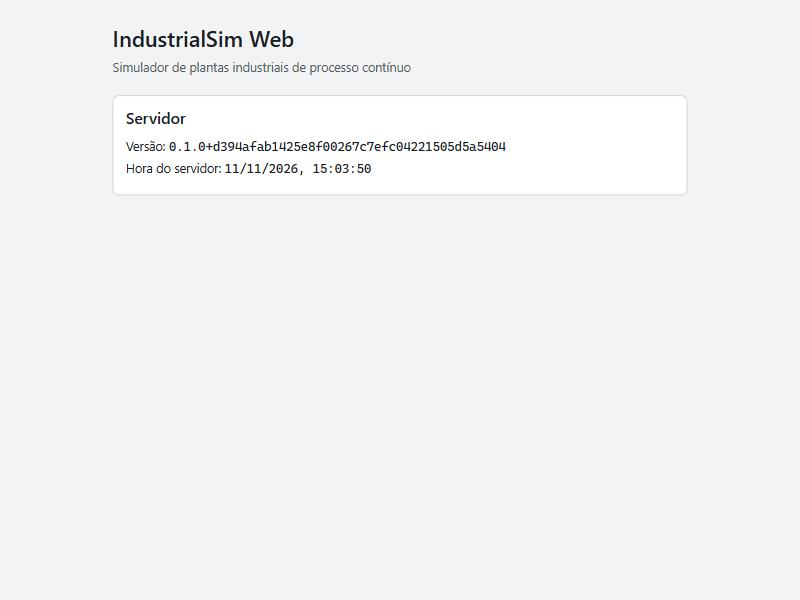

# Validação — Etapa 0: Fundação do repositório e CI

- Branch: `etapa-00-fundacao`
- Pull request: [Saulojo/industrialsim-web#1](https://github.com/Saulojo/industrialsim-web/pull/1)
- Data: 11/11/2026

## Ambiente

| Item | Versão |
| --- | --- |
| Sistema (local) | Windows 11 Pro 10.0.26300 |
| .NET SDK | 10.0.404 (fixado em `global.json`: 10.0.100 com `rollForward: latestFeature`) |
| Runtime ASP.NET Core | 10.0.15 |
| Node.js / npm | 26.13.0 / 11.20.0 |
| CI | GitHub Actions, `ubuntu-latest` |

Principais pacotes (versões exatas nos arquivos de lock): xunit.v3 4.0.3, Microsoft.AspNetCore.Mvc.Testing 10.0.15, Vite 8.3.8, React 19.3.1, TypeScript 6.0.3, ESLint 10.14.0, typescript-eslint 8.72.2, eslint-plugin-i18next 6.1.5, stylelint 18.0.0, Vitest 5.1.0, i18next 27.1.1, react-i18next 18.0.1.

## Critérios

| # | Critério | Como foi verificado | Resultado |
| --- | --- | --- | --- |
| 1 | `dotnet build` e `dotnet test` passam sem avisos numa máquina limpa | `git clean -xfd server`, depois restore com `--locked-mode`, build com `-warnaserror` e testes; repetido num clone novo e no CI (máquina nova a cada execução) | ✅ 0 avisos, 0 erros; 6/6 testes |
| 2 | `npm ci`, `npm run lint`, `npm test` e `npm run build` passam | Local, num clone novo e no CI | ✅ 10/10 testes; lint e build sem erros |
| 3 | Com o servidor rodando, a página mostra a versão vinda de `/api/health` | `dotnet run` num clone novo + navegador; teste de integração (`HealthEndpointTests`), teste do componente (`HealthStatus.test.tsx`) e job `integration` do CI | ✅ captura abaixo |
| 4 | Um texto fixo colocado de propósito num componente faz o lint falhar | Demonstração manual em `App.tsx` + teste permanente `web/tests/lint-rules.test.ts` | ✅ ESLint saiu com código 1 |
| 5 | O CI fica verde num PR e vermelho quando um teste é quebrado de propósito | PR #1: execução verde; commit que quebra um teste → vermelho; revert → verde | ✅ links na seção 5 |
| 6 | Outra pessoa segue o README e roda o projeto sem ajuda | Ensaio feito pelo Claude num clone limpo seguindo só o README; depois, outra pessoa seguiu o README e rodou o projeto (resultado informado pelo Saulo) | ✅ |

## 1. Build e testes do .NET numa máquina limpa

```text
$ git clean -xfdq server
$ cd server
$ dotnet restore --locked-mode
  ... restaurado (8 projetos)
$ dotnet build --no-restore -warnaserror
Compilação com êxito.
    0 Aviso(s)
    0 Erro(s)
$ dotnet test --no-build
  IndustrialSim.Server.Tests.dll (net10.0|x64) aprovado
  IndustrialSim.Contracts.Tests.dll (net10.0|x64) aprovado
  IndustrialSim.IO.Tests.dll (net10.0|x64) aprovado
  IndustrialSim.Core.Tests.dll (net10.0|x64) aprovado
  total: 6
  falhou: 0
  concluído com êxito: 6
  ignorados: 0
  duração: 6s 260ms
```

Testes .NET:

| Projeto | Teste | O que garante |
| --- | --- | --- |
| Core.Tests | `Core_DoesNotReferenceNetworkOrHostAssemblies` | RNF08: núcleo sem rede nem host |
| IO.Tests | `IO_DoesNotReferenceNetworkOrHostAssemblies` | RNF08: imagem de I/O sem rede |
| Contracts.Tests | `Serializes_WithCamelCasePropertyNames`, `RoundTrips_ThroughJson` | Formato JSON do contrato |
| Server.Tests | `Health_ReturnsVersionAndServerTime` | `/api/health` devolve a versão do assembly e a hora (relógio fixo) |
| Server.Tests | `UnknownApiRoute_Returns404` | `/api/...` desconhecido não cai na página |

## 2. Web: `npm ci`, lint, testes e build

```text
$ cd web
$ npm ci
$ npm run lint
> eslint . && stylelint "src/**/*.css" && prettier --check .
Checking formatting...
All matched files use Prettier code style!
$ npm test
 Test Files  3 passed (3)
      Tests  10 passed (10)
$ npm run build
> tsc --noEmit && vite build
../server/src/IndustrialSim.Server/wwwroot/index.html                  0.40 kB │ gzip:  0.27 kB
../server/src/IndustrialSim.Server/wwwroot/assets/index-*.css           2.28 kB │ gzip:  0.79 kB
../server/src/IndustrialSim.Server/wwwroot/assets/index-*.js          288.04 kB │ gzip: 91.27 kB
✓ built
```

Testes web: cliente de `/api/health` (2), componente `HealthStatus` (2), regras de lint (6: texto fixo no JSX, texto fixo em atributo visível, texto via `t()` aceito, cor fixa, espaçamento fixo, tokens aceitos).

## 3. Página mostrando a versão de `/api/health`

Num clone novo da branch, seguindo o README: `npm run build` em `web/` e `dotnet run` em `server/src/IndustrialSim.Server`.

```text
$ curl http://localhost:5080/api/health
{"version":"0.1.0+d394afab1425e8f00267c7efc04221505d5a5404","serverTimeUtc":"2026-11-11T18:03:47.4004099+00:00"}
GET /        -> 200 (index.html do build)
GET /api/x   -> 404
```



A versão `0.1.0+d394afa…` é a `Version` do `Directory.Build.props` mais o commit da build. A hora aparece formatada em pt-BR, no fuso do navegador.

## 4. Texto fixo faz o lint falhar

Linha inserida de propósito em `web/src/ui/App.tsx`: `<p>Texto fixo de teste</p>`.

```text
$ npx eslint src/ui/App.tsx
C:\Projetos\industrialsim-web\web\src\ui\App.tsx
  17:12  error  Texto de interface fixo no componente. Coloque-o em src/locales e use t("chave").: <p>Texto fixo de teste</p>  i18next/no-literal-string

✖ 1 problem (1 error, 0 warnings)
eslint exit=1

$ git checkout -- src/ui/App.tsx && npx eslint src/ui/App.tsx
revertido, lint ok
```

A regra também é coberta por teste automático (`web/tests/lint-rules.test.ts`), então não pode ser desligada sem quebrar o CI.

**Limitação conhecida:** o eslint-plugin-i18next ignora strings atribuídas a constantes com nome todo em maiúsculas (`const TITLE = '...'`). Esse caso fica para a revisão de código.

## 5. CI verde e vermelho

Execuções do workflow `CI` no PR #1 (evento `pull_request`):

| Commit | O que mudou | Execução | .NET | Web | Integração | Resultado |
| --- | --- | --- | --- | --- | --- | --- |
| `d394afa` | Partes A, B e C | [43074984572](https://github.com/Saulojo/industrialsim-web/actions/runs/43074984572) | ✅ | ✅ | ✅ | 🟢 verde |
| `be1928a` | Teste quebrado de propósito (`"1.2.3"` → `"9.9.9"` no JSON esperado) | [43075329198](https://github.com/Saulojo/industrialsim-web/actions/runs/43075329198) | ❌ | ✅ | ⏭️ pulado | 🔴 vermelho |
| `5e35ef7` | Revert do teste quebrado + esta validação | [43076136015](https://github.com/Saulojo/industrialsim-web/actions/runs/43076136015) | ✅ | ✅ | ✅ | 🟢 verde |

O evento `push` gerou execuções paralelas com o mesmo resultado (ex.: [43075321717](https://github.com/Saulojo/industrialsim-web/actions/runs/43075321717), vermelha, para `be1928a`).

Falha registrada no CI com o teste quebrado:

```text
failed IndustrialSim.Contracts.Tests.HealthResponseTests.Serializes_WithCamelCasePropertyNames (79ms)
  Assert.Equal() Failure: Strings differ
  Expected: "{"version":"9.9.9","serverTimeUtc":"2026-11-11T12:"···
  Actual:   "{"version":"1.2.3","serverTimeUtc":"2026-11-11T12:"···
IndustrialSim.Contracts.Tests.dll (net10.0|x64) failed with 1 error(s)
  total: 6
  failed: 1
```

O revert (`07f9258`) devolve o código exatamente ao estado de `d394afa`: `git diff d394afa 07f9258 -- server` fica vazio.

Na execução verde final, o job de integração subiu o servidor no runner Linux e conferiu a API e a página:

```text
{"version":"0.1.0+88092e665f3fea1efcb870e01fe4e1671d22e88e","serverTimeUtc":"2026-11-11T18:18:46.6609054+00:00"}
Servidor respondeu /api/health e serviu a página.
```

O hash `88092e6` é o commit de merge que o GitHub cria para testar o PR contra a `main`.

**Proteção da `main`** (configurada em 11/11/2026 via API do GitHub): merge só por pull request; os checks `.NET (build e testes)`, `Web (lint, testes e build)` e `Integração (servidor servindo o web)` precisam estar verdes, com a branch atualizada; sem force push nem exclusão; as regras valem também para administradores.

## 6. Outra pessoa segue o README

Ensaio prévio, feito pelo Claude num clone limpo da branch (Windows, SDK 10.0.404, Node 26.13.0), seguindo só o README: todos os passos funcionaram, e a página mostrou a versão.

**Teste com outra pessoa:** em 11/11/2026, o Saulo informou que outra pessoa seguiu o README e rodou o projeto sem ajuda, com sucesso. Nome, sistema operacional e capturas desse teste não foram registrados; podem ser acrescentados aqui depois.

## Observações

- **Licenças.** Dependências de produção do web: todas MIT (React, i18next, react-i18next). NuGet: xunit.v3 (Apache-2.0) e Mvc.Testing (MIT), ambos só de teste. Fora da lista MIT/Apache/BSD, só há dependências indiretas de build, que não entram no site publicado: lightningcss (MPL-2.0, via Vite), caniuse-lite (CC-BY-4.0, via browserslist) e argparse (PSF-2.0, via js-yaml). Nenhuma é GPL nem comercial.
- **`npm audit`.** Um alerta moderado (ReDoS no minimatch), presente só na cadeia do ESLint (ferramenta de desenvolvimento). A correção sugerida rebaixaria o ESLint para a versão 9. Aceito por ora; será revisto quando o ESLint publicar a correção.
- **TypeScript fixado em 6.0.3.** O typescript-eslint 8.72 aceita TypeScript abaixo de 6.1. Atualizar para o TS 7 quando o typescript-eslint passar a aceitá-lo.
- **Tipos TS do contrato** (`web/src/net/health.ts`) escritos à mão nesta etapa; a geração a partir do C# (D05) vem na Etapa 7.
- **`.gitattributes` com `eol=lf`**, para o Prettier e o CI verem os mesmos finais de linha no Windows (`core.autocrlf=true`).
- **Porta local de desenvolvimento `5080`.** É só para `localhost` e não é exposta. As portas públicas continuam as do descritivo (443 e as faixas de planta).
